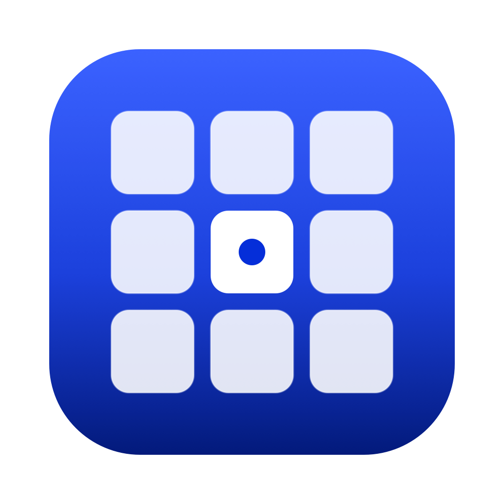

<p align="center">
  
</p>

<h1 align="center">LogiKeyPad Dev Pad</h1>

<p align="center">
  A native Swift macOS app that turns the <strong>Logitech MX Creative Keypad</strong> into a
  code-development control surface — 36 pre-programmed LCD keys on 4 pages for
  <strong>Muse, Codex, and Claude Code</strong>, build/test, Git, and GitHub.<br>
  Direct USB HID from Swift/IOKit. <strong>No Logi Options+ required.</strong>
</p>

---

## What it does

Press a physical key, something useful happens in your repo — and the keys
themselves show live state (current branch, dirty/staged counts, ↑ahead,
CI PASS/FAIL, focus-timer countdown). The keypad's ◀ ▶ page buttons cycle
pages on the device and in the app simultaneously.

| Page | Keys |
|---|---|
| **Agents** | Muse app · Codex app · Claude Code (Terminal) · Claude app · Muse CLI · *Review my diff* · *Explain my diff* · *Write tests* · *Commit message* (prompts copied to clipboard with live diff context, ready to paste into any agent) |
| **Build** | Build · Test · Run · Format · Lint · Dev server (start/stop, streamed) · Clean (confirms in app) · Terminal here · Editor — commands auto-detected per project (SwiftPM / npm scripts / Xcode / Make) |
| **Git** | Status *(branch badge)* · Stage all *(dirty count)* · Commit *(staged count; message field in app)* · Push *(↑n badge)* · Pull ff-only *(↓n badge)* · Fetch · Stash push/pop · Diff in editor · Copy branch name |
| **GitHub** | PR open/create · CI checks *(PASS/FAIL badge)* · Re-run failed CI · Reviews for me · Repo on GitHub · Copy PR link · Standup (today's commits → clipboard) · Focus 25-min *(countdown on the key + menu bar)* · Quick note → `NOTES.md` |

**Repo picker (GitHub-synced).** *Repos…* lists your most recently pushed
GitHub repos (**Recent 5 / Recent 10** toggle), each resolved to its local
clone by matching `origin` URLs under `~/Developer`, `~/Downloads`, etc. —
folder names don't need to match repo names. Repos without a clone get a
one-click **Clone** button. Sync runs on launch (cached 6 h) or on demand;
*Choose Folder…* covers anything off GitHub.

**Two themes** — Midnight (black keys, white text) and Blueprint (blue keys,
white text) — apply to the device LCDs, the window grid, and were designed
to be read at a glance. Right-click any key in the window to reassign it;
the device repaints instantly.

## Why direct HID?

Logitech's Actions SDK only ships Node.js/C# bindings whose plugins must be
hosted by Logi Options+ — and its Node SDK (v0.1.1) exposes no way to update
key faces dynamically. The MX Creative Keypad also speaks HID++ 4.5 over
plain vendor HID reports, openly reverse-engineered by the
[julusian/node-logitech-mx-creative-console](https://github.com/julusian/node-logitech-mx-creative-console)
project. This app implements that protocol directly in Swift:

| Report | Purpose |
|---|---|
| `0x13` in | LCD key presses: `FF 02 00 <seq> 01 <key ids 1…9>` (down/up by set diff; holds & chords work) |
| `0x11` in/out | HID++ requests; page buttons via reprogrammable-controls (feature index `0x0B`, divert `0x01A1/0x01A2`) |
| `0x14` out | LCD paint: JPEG tiles chunked at 4095 B onto one 480×480 panel; keys are 118×118 @ `x=23+c·158, y=6+r·158` |

Every leg was verified byte-for-byte on real hardware with the included
probe (`scripts/hid-probe.swift` — try `listen` and press keys). Two macOS
traps worth knowing if you build on this: `IOHIDDeviceSetReport` buffers
must **include** the report-ID byte or the frame shifts and the device
stays silent; and there must be exactly **one** input-report callback
registration (per-ID buffers replace each other and truncate).

An Actions SDK plugin (`plugin/`, TypeScript) is included as an alternative
transport for the same 36 actions — that path *does* require Options+.
`Sources/LogiKeyPad/Resources/catalog.json` is the single source of truth
for both.

## Requirements

- macOS 14+ (developed on macOS 27 / Xcode 27.1, Swift 6.4)
- Logitech **MX Creative Keypad** on USB-C (`046D:C354`)
- Optional but recommended: [`gh`](https://cli.github.com) authenticated
  (repo picker, PR/CI keys) — everything else works without it
- Node 22+ **only** for the optional Actions SDK plugin
- Do **not** run Logi Options+ or OpenLogi at the same time — they contend
  for the device (OpenLogi doesn't support this keypad)

## Quick start

```sh
git clone https://github.com/neuroccm/LogiKeyPadMacOSSwift.git
cd LogiKeyPadMacOSSwift
swift test                    # 14 tests
./scripts/build-dmg.sh        # app + fresh timestamped DMG on ~/Desktop
```

Open the DMG, drag **LogiKeyPad** to Applications, launch it (first launch:
right-click → Open, it's ad-hoc signed for private use). Then:

1. **Repos…** → pick a cloned repo (or Clone one).
2. Page through with the keypad's ◀ ▶ buttons; try **Git → Status**.
3. Tick **Launch at login** if you want it always armed.

First Claude-Code-in-Terminal press asks for Automation permission
(LogiKeyPad → Terminal) once. Config lives in
`~/Library/Application Support/LogiKeyPad/` (`config.json`, GitHub cache,
bridge token) — nothing of yours lives in this repo.

## Architecture

```text
MX Creative Keypad ──USB HID──▶ MXKeypadHID (IOKit, hot-plug)
        ▲                             │ key/page events
        │ JPEG tiles (480×480)        ▼
        └──────── KeyArt ◀── AppState ──▶ Executor ── git / gh / shells
                                ▲  │
                     RepoMonitor┘  └─ GitHubSync (gh repo list + clone scan)
        (optional) Actions SDK plugin ──127.0.0.1 bridge──▶ Executor
```

- **Event-driven, not polled.** Repo state refreshes on kernel `.git` file
  events (300 ms debounce); `gh` runs on demand; the panel repaints only
  when page/theme/layout/a badge actually changes (hash-gated); the focus
  timer is the sole 1 Hz tick, repainting one 118 px tile.
- **Capped everything.** Shell output (256 KB), log lines (300), bridge
  frames, clone-scan candidates (800) — a runaway command can't grow memory.
- **Local-first & private.** No accounts, no telemetry, no network except
  what `gh`/`git` do on your behalf. The optional localhost bridge requires
  a shared token (`bridge-token`, mode `0600`) because key presses can run
  shell commands; unauthenticated messages are ignored (probed).
- **Destructive actions confirm in-app** (Clean today; the pattern is
  `confirm: true` in the catalog).

## Project layout

```text
Sources/LogiKeyPad/
  LogiKeyPadApp.swift   App, menu bar, AppState (wiring, badges, painting)
  ContentView.swift     Window: key grid, repo picker, log console
  MXKeypadHID.swift     Direct-HID driver + tested packet builders/parsers
  KeyArt.swift          Exact-pixel 480×480 panel / 118×118 tile JPEG renders
  RepoMonitor.swift     git/gh state engine (FSEvents-style .git watching)
  GitHubSync.swift      gh repo list + local-clone resolution + cache
  Executor.swift        The 36 actions over ~8 primitives
  Shell.swift           Capped async process runner + streaming long task
  BridgeServer.swift    Token-authenticated localhost bridge (SDK plugin path)
  Models.swift          Catalog, config, themes, repo state, wire format
  Resources/catalog.json  ← single source of truth for all keys
plugin/                 Optional Logi Actions SDK transport (TypeScript)
scripts/
  build-app.sh          Release .app → ./build (ad-hoc signed)
  build-dmg.sh          Standard rebuild: app + NEW timestamped Desktop DMG
  hid-probe.swift       Hardware probe: info | listen | hidpp | paint
  make-icon.swift       Renders assets/AppIcon.icns (blue/white key grid)
Tests/                  Catalog, git parsing, bridge codec, HID framing, renders
```

## Development

```sh
swift test                                   # unit tests (no hardware needed)
swift scripts/hid-probe.swift listen 120     # live key reports (hardware)
swift scripts/hid-probe.swift paint 4        # paint test tile on center key
cd plugin && npm run build:pack              # optional SDK transport (.lplug4)
```

Reassigning keys, adding pages, or adding actions starts in `catalog.json`
(+ one `Executor` case for genuinely new behavior). The window grid, device
faces, SDK plugin, and tests all derive from it.

## Roadmap

- **Visible-in-terminal execution** (designed, process-table sampling done):
  optionally run Git/Build commands in the *existing* Terminal.app window
  whose shell sits in the selected repo — matched by tty + cwd, guarded by
  a foreground-idle check so text never lands inside a running program;
  Ghostty falls back to frontmost-window + clipboard.
- Brightness control (HID++ feature identified, not yet wired).
- Per-repo page sets and editor-frontmost repo auto-switching.
- Long-press key variants (down/up are already distinct events).

## Credits & references

- [julusian/node-logitech-mx-creative-console](https://github.com/julusian/node-logitech-mx-creative-console) — the open protocol implementation this driver ports and verifies
- [Logi Actions SDK docs](https://logitech.github.io/actions-sdk-docs/) — the official (Options+-hosted) path in `plugin/`
- [OpenLogi](https://github.com/aprilnea/openlogi) — the local-first ethos (different devices, same spirit)
- [The next developer interface is ambient intelligence](https://github.blog/news-insights/company-news/the-next-developer-interface-is-ambient-intelligence/) (GitHub Blog) — the idea that started this

## License & contributions

Copyright © 2026 Houman Khosravani. **All rights reserved** — this repository
is public for reading and learning; no license to use, copy, or redistribute
is granted. The project is not accepting contributions, issues, or pull
requests at this time (repository features are locked down accordingly).
"Logitech", "Logi", and "MX Creative" are trademarks of Logitech; this is an
independent personal project, not affiliated with or endorsed by Logitech.
